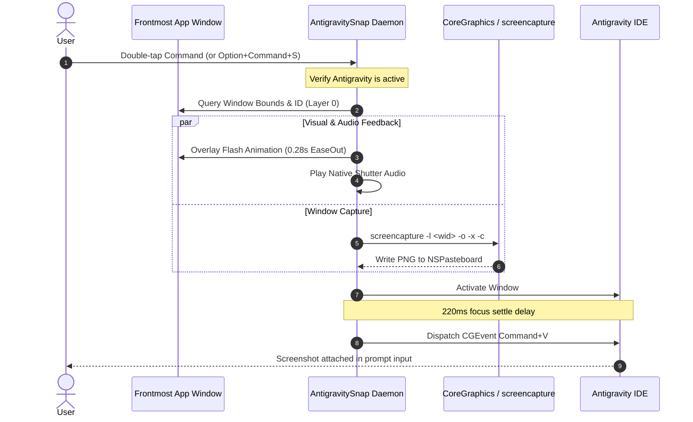

# AntigravitySnap

[](LICENSE)
[](https://www.apple.com/macos/)
[](https://www.swift.org/)
[](https://github.com/google-deepmind)

Native macOS background companion daemon for Google Antigravity IDE. It captures the active frontmost application window with hardware-accelerated visual feedback and camera shutter audio, switches focus to Antigravity, and automatically pastes the screenshot into the active composer.

---

## Architecture Overview



---

## Core Characteristics

- **Strict Process Lifecycle Coupling**: The daemon actively monitors the running state of `Antigravity`. Global key monitors are attached only while Antigravity is running; when Antigravity exits, all hooks are detached.
- **Zero Interface Overhead**: Configured with `NSApplication.ActivationPolicy.prohibited`. Does not display items in the menu bar, Dock, or status bar.
- **Hardware-Targeted Capture**: Automatically resolves target `CGWindowID` via Quartz Window Services to capture the exact active window rectangle without desktop clutter.
- **Low Latency & Minimal Footprint**: Compiled as a native ARM64 / x86_64 Mach-O binary. Memory footprint is below 35 MB, with 0.0% idle CPU usage.

---

## Prerequisites

- macOS 13.0 or later
- Swift 6.0+ command line tools (`xcode-select --install`)
- Accessibility permissions granted to the running binary or terminal (`System Settings -> Privacy & Security -> Accessibility`)
- Screen Recording permissions granted to macOS `screencapture` (`System Settings -> Privacy & Security -> Screen Recording`)

---

## Build and Installation

### 1. Compile from Source

```bash
git clone https://github.com/ZHUOLIN0928/antigravity-screen-snap.git
cd antigravity-screen-snap
make
```

### 2. Install to Binary Path

```bash
make install
# Binary copied to ~/.local/bin/AntigravitySnap
```

### 3. Setup macOS launchd Service (Optional, Auto-start)

```bash
cp com.antigravity.snap.plist ~/Library/LaunchAgents/
launchctl load ~/Library/LaunchAgents/com.antigravity.snap.plist
```

---

## Usage

When Antigravity IDE is open, use either of the following input triggers from any application:

1. **Double-tap Command Key**: Press the `Command` key twice rapidly (interval between 50 ms and 350 ms).
2. **Global Key Combination**: Press `Option + Command + S`.

Execution sequence:
1. Active window border highlights with a 0.28s ease-out flash.
2. System shutter audio plays.
3. Target window image writes to system clipboard.
4. Antigravity IDE focuses and executes `Command + V` into the input prompt.

---

## Technical Specifications

| Parameter | Specification |
| :--- | :--- |
| Implementation Language | Swift 6 (Cocoa, CoreGraphics, ApplicationServices) |
| Binary Size | ~87 KB (Mach-O 64-bit executable) |
| Audio Source | `/System/Library/Components/CoreAudio.component/.../Screen Capture.aif` |
| Overlay Window Level | `kCGScreenSaverWindowLevel` (transient visual feedback) |
| Target Resolution | Screen native resolution with Retina HiDPI support |
| License | MIT |

---

## 中文说明

### 项目简介
AntigravitySnap 是专为 Google Antigravity IDE 设计的 macOS 原生常驻辅助进程。在任意应用窗口下通过双击 Command 键或按下 `Option + Command + S`，即可完成当前窗口捕获、视觉与音效反馈、自动切回 Antigravity 窗口并将截图粘贴至输入框。

### 关键特性
1. **严格生命周期联动**：仅在检测到 Antigravity IDE 运行时激活全局按键监听；IDE 退出后自动释放监听钩子。
2. **零界面常驻**：采用 `NSApplication.ActivationPolicy.prohibited`，不占用状态栏、Dock 栏与菜单栏空间。
3. **精准窗口定位**：基于 Quartz 窗口层级识别当前前台活跃窗口 ID，避免桌面多余元素干扰。
4. **低资源占用**：原生 Swift 编译，内存占用低于 35 MB，待机 CPU 占用为 0.0%。

---

## Metadata & Search Keywords (SEO / GEO)

- **Product Category**: Developer Tools, AI Agent Utilities, macOS Daemons
- **Target Applications**: Google Antigravity IDE, Agentic AI Coding Workspaces
- **Core Functionality**: Native Window Capture, Instant Focus Shift, Clipboard Dispatch, Low-latency Swift Daemon
- **Semantic Keywords**: `antigravity`, `antigravity-ide`, `macos-screenshot`, `swift-daemon`, `developer-tools`, `multimodal-agent-input`, `window-capture`, `hotkey-daemon`

---

## License

[MIT License](LICENSE) © 2026 ZHUOLIN
